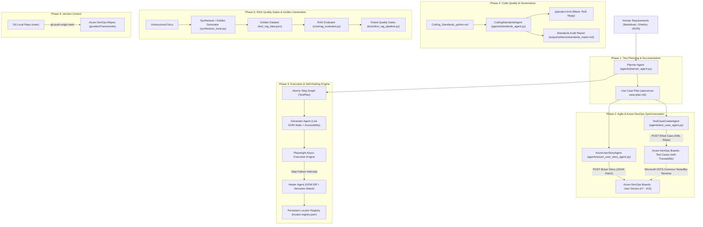

# Autonomous Agentic Playwright Framework - Implementation Plan & Progress Tracking

## Executive Summary
This document defines the architectural plan, technical decision rationale, implementation roadmap, and execution tracking for the **Autonomous Agentic Playwright Framework**, including:
1. **LLM & RAG Testing Quality Gating Framework**
2. **Use Case Test Scenario Planner Engine (`specs/use-case-plan.md`)**
3. **Python Coding Standards Enforcement Agent (`Coding_Standards_python.md`)**
4. **Azure DevOps Agile Work Item Automation (`AzureUserStoryAgent` & `TestCaseCreateAgent`)**
5. **Azure DevOps Git Repository Synchronization**

---

## 1. System Architecture & Component Design

---

## 2. Decision Rationale & Technical Choices

### A. Model-Agnostic LLM Evaluator Architecture
- **Decision**: Build a resilient, dual-provider evaluation engine (`core/rag_evaluator.py`) supporting both local Ollama (`http://localhost:11434/v1`) and OpenAI-compatible API endpoints.
- **Rationale**: Ensures compliance with NFR-01 (air-gapped/self-hosted deployment with local 8B–70B models like `Llama-3.1-8B` and `Qwen-2.5-14B/32B`).

### B. Standardized Use Case Template Structure
- **Decision**: Enforce strict Use Case Markdown formatting in `agents/planner_agent.py` (`Actor`, `Preconditions`, `Main Flow / Steps`, `Alternate / Exception Flows`, `Expected Outcome`).
- **Rationale**: Guarantees consistent scenario decomposition across heterogeneous requirement formats (Gherkin, User Stories, Plain Text) and provides an automated source of truth for both test execution and Agile board synchronization.

### C. Zero-Dependency Coding Standards Agent
- **Decision**: Build `CodingStandardsAgent` with pure Python AST parsing and lexical regex analysis, paired with automatic `pyproject.toml` generation for Ruff, Black, and Mypy.
- **Rationale**: Enables automated PEP 8 auditing and auto-fixing in any environment even before third-party linters are installed.

### D. Temporary JSON-Patch Buffering for Azure DevOps REST API
- **Decision**: Use temporary files (`tempfile.NamedTemporaryFile`) to pass multi-line HTML and XML payloads to `curl.exe` via `-d @temp_file.json`.
- **Rationale**: Eliminates Windows command-line quoting, escaping, and UTF-8 encoding corruption when creating Work Items with rich text and XML test steps.

### E. Traceability Linking Between Test Cases and User Stories
- **Decision**: Automatically extract created User Story IDs from `specs/azure-user-stories.md` and attach `Microsoft.VSTS.Common.TestedBy-Reverse` relations when creating Test Cases.
- **Rationale**: Establishes 100% end-to-end traceability in Azure DevOps Boards from requirements down to executable test steps.

---

## 3. Step-by-Step Implementation Roadmap

- [x] **Step 1**: Define Pydantic models for RAG test cases, metrics, golden sets, and evaluation reports in `schema/rag_eval.py`.
- [x] **Step 2**: Implement core RAG evaluation metrics and judge interface in `core/rag_evaluator.py` supporting Faithfulness, Answer Relevancy, Contextual Precision, and Contextual Recall.
- [x] **Step 3**: Create synthetic golden dataset generator (`synthesizer_local.py`) with semantic chunking, dual-model drafting/critic filtering, and question evolutions.
- [x] **Step 4**: Generate and validate `test_rag_data.json` containing standard, out-of-scope, empty retrieval, and prompt injection adversarial cases.
- [x] **Step 5**: Implement automated Pytest evaluation suite in `tests/test_rag_pipeline.py` with HTML/JSON report logging.
- [x] **Step 6**: Create GitHub Actions CI/CD workflow `.github/workflows/rag_eval.yml`.
- [x] **Step 7**: Update and expand `userguide.md` with complete documentation on RAG evaluation, local Ollama configuration, dataset generation, and Pytest quality gates.
- [x] **Step 8**: Implement Use Case Test Planner in `agents/planner_agent.py` exporting `specs/use-case-plan.md` adhering to the exact Use Case template (`UC-01` to `UC-09`).
- [x] **Step 9**: Add `--plan-output` and `--plan-only` CLI arguments to `main.py` and `engine/runner.py`.
- [x] **Step 10**: Implement `CodingStandardsAgent` in `agents/standards_agent.py` enforcing `Coding_Standards_python.md` with AST auditing, auto-fixing, and `pyproject.toml` generation.
- [x] **Step 11**: Initialize Git repository with comprehensive `.gitignore` and push initial code to Azure DevOps (`govidev/Frameworks`).
- [x] **Step 12**: Implement `AzureUserStoryAgent` in `agents/azure_user_story_agent.py` conforming to `CreateUserStory.md` and publish User Stories (`#7` through `#15`) to Azure DevOps Boards.
- [x] **Step 13**: Implement `TestCaseCreateAgent` in `agents/test_case_agent.py` conforming to `CreateTestCases.md` with XML test step generation (`Microsoft.VSTS.TCM.Steps`) and User Story traceability linking.
- [x] **Step 14**: Execute `TestCaseCreateAgent` to publish all 9 Test Cases (`#17` through `#25`) into Azure DevOps Boards linked to parent User Stories (`#7` through `#15`) and output `specs/azure-test-cases.md`.
- [x] **Step 15**: Update `userguide.md` and `PLAN.md` with comprehensive documentation, traceability matrices, and progress logs.
- [x] **Step 16**: Create step-wise [`Workflow.md`](file:///e:/AI_PORTABLE/PROJECTS/playwrightFrameworkPythons/Workflow.md) documenting the 8-step operational lifecycle from environment initialization to Azure DevOps check-in.

---

## 4. Execution Log & Progress Tracking

| Step | Action Taken | Result / Finding | Status |
|---|---|---|---|
| 1 | Create schema models in `schema/rag_eval.py` | Validated Pydantic models for LLMTestCase, RAGMetricScore, SyntheticGoldenItem, RAGEvalReport. | Completed |
| 2 | Create evaluator engine in `core/rag_evaluator.py` | Added LLM-Judge & heuristic evaluation for 4 core RAG metrics + prompt injection defense. | Completed |
| 3 | Create synthesizer in `synthesizer_local.py` | Dual-model draft/critic synthesizer verified with local chunking and CLI parameters. | Completed |
| 4 | Create golden dataset in `test_rag_data.json` | Created curated test cases covering standard, out-of-scope refusal, empty retrieval, and prompt injection. | Completed |
| 5 | Create Pytest suite in `tests/test_rag_pipeline.py` | Automated quality gate suite exporting JSON report to `output/artifacts/reports/rag_eval_report.json`. | Completed |
| 6 | Create CI/CD workflow `.github/workflows/rag_eval.yml` | Configured GitHub Actions matrix strategy for automated evaluation on PRs. | Completed |
| 7 | Create Use Case Test Planner in `agents/planner_agent.py` | Generated 9 Use Case scenarios (`UC-01` to `UC-09`) saved to `specs/use-case-plan.md` matching target template. | Completed |
| 8 | Validate Playwright runner execution | Executed 24/24 atomic steps against `https://shop.qaautomationlabs.com` in 5.56s (100% pass rate). | Completed |
| 9 | Implement `CodingStandardsAgent` in `agents/standards_agent.py` | Created pure AST engine enforcing PEP 8 rules, auto-fixing tabs/blank lines/imports, and generating `pyproject.toml`. | Completed |
| 10 | Git Repository Initialization & Remote Push | Initialized repository, created `.gitignore`, configured Windows Credential Manager, and pushed to Azure DevOps `main`. | Completed |
| 11 | Implement `AzureUserStoryAgent` in `agents/azure_user_story_agent.py` | Published User Stories `#7` through `#15` directly into Azure DevOps Boards and created `specs/azure-user-stories.md`. | Completed |
| 12 | Implement `TestCaseCreateAgent` in `agents/test_case_agent.py` | Built XML step generator conforming to `CreateTestCases.md` and linked test cases to parent user stories. | Completed |
| 13 | Execute `TestCaseCreateAgent` (`python main.py --test-cases`) | Published 9 Test Cases (`#17` through `#25`) in Azure DevOps Boards with XML steps and linked to User Stories `#7`–`#15`. | Completed |
| 14 | Synchronize Documentation in `userguide.md` & `PLAN.md` | Documented all new CLI flags, agents, architecture diagrams, traceability links, and Azure DevOps integration workflows. | Completed |
| 15 | Create `Workflow.md` operational guide | Generated step-wise operational guide with Mermaid workflow diagrams, CLI cheat sheet, and troubleshooting matrix. | Completed |

