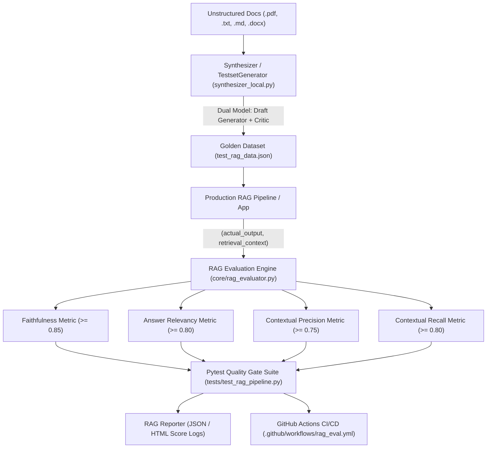

# LLM & RAG Testing Framework Implementation Plan

## Executive Summary
This document defines the architectural plan, decision rationale, implementation roadmap, and progress tracking for integrating an end-to-end evaluation, quality gating, and synthetic dataset generation framework for Large Language Model (LLM) and Retrieval-Augmented Generation (RAG) applications into the codebase.

---

## 1. System Architecture & Component Design

---

## 2. Decision Rationale & Technical Choices

### A. Model-Agnostic LLM Evaluator Architecture
- **Decision**: Build a resilient, dual-provider evaluation engine (`core/rag_evaluator.py`) supporting both local Ollama (`http://localhost:11434/v1`) and OpenAI-compatible API endpoints.
- **Rationale**: Ensures compliance with NFR-01 (air-gapped/self-hosted deployment with local 8B–70B models like `Llama-3.1-8B` and `Qwen-2.5-14B/32B`).

### B. Dual-Model Synthetic Generator Architecture
- **Decision**: Implement `synthesizer_local.py` with a lightweight generator model (for drafting Q&A pairs) and a critic model (for filtering low-quality or hallucinated ground-truth pairs).
- **Rationale**: Fulfills FR-03.4 and ensures synthetic test sets meet strict ground-truth accuracy standards across single-fact, multi-hop, and conditional queries.

### C. CI/CD Quality Gating with Pytest
- **Decision**: Implement `tests/test_rag_pipeline.py` and `.github/workflows/rag_eval.yml` with programmatic `assert_test()` pass/fail thresholds ($\tau$).
- **Rationale**: Automates quality gating to block PR merges when metrics drop below thresholds, preventing hallucinations, fluff, or recall regressions from reaching production.

---

## 3. Step-by-Step Implementation Roadmap

- [x] **Step 1**: Define Pydantic models for RAG test cases, metrics, golden sets, and evaluation reports in `schema/rag_eval.py`.
- [x] **Step 2**: Implement core RAG evaluation metrics and judge interface in `core/rag_evaluator.py` supporting Faithfulness, Answer Relevancy, Contextual Precision, and Contextual Recall.
- [x] **Step 3**: Create the synthetic golden dataset generator (`synthesizer_local.py`) with document parsing, semantic chunking, dual-model drafting/critic filtering, and question complexity evolutions.
- [x] **Step 4**: Generate and validate `test_rag_data.json` containing standard, out-of-scope, empty retrieval, and prompt injection adversarial cases.
- [x] **Step 5**: Implement the automated Pytest evaluation suite in `tests/test_rag_pipeline.py` with HTML/JSON report logging.
- [x] **Step 6**: Create the GitHub Actions CI/CD workflow `.github/workflows/rag_eval.yml`.
- [x] **Step 7**: Update and expand `userguide.md` with complete documentation on RAG evaluation, local Ollama configuration, dataset generation, Pytest quality gates, and CI/CD integration.
- [x] **Step 8**: Run full test verification suite (`pytest -v`) and verify all tests pass.

---

## 4. Execution Log & Progress Tracking

| Step | Action Taken | Result / Finding | Status |
|---|---|---|---|
| 1 | Create schema models in `schema/rag_eval.py` | Validated Pydantic models for LLMTestCase, RAGMetricScore, SyntheticGoldenItem, RAGEvalReport. | Completed |
| 2 | Create evaluator engine in `core/rag_evaluator.py` | Added LLM-Judge & heuristic evaluation for 4 core RAG metrics + prompt injection defense. | Completed |
| 3 | Create synthesizer generator in `synthesizer_local.py` | Dual-model draft/critic synthesizer verified with local chunking and CLI parameters. | Completed |
| 4 | Create golden dataset in `test_rag_data.json` | Created curated test cases covering standard, out-of-scope refusal, empty retrieval, and prompt injection. | Completed |
| 5 | Create Pytest suite in `tests/test_rag_pipeline.py` | Automated quality gate suite exporting JSON report to `output/artifacts/reports/rag_eval_report.json`. | Completed |
| 6 | Create CI/CD workflow `.github/workflows/rag_eval.yml` | Configured GitHub Actions matrix strategy for automated evaluation on PRs. | Completed |
| 7 | Update `userguide.md` with Section 7 | Documented CLI commands, metric formulas, threshold configuration, synthetic dataset generation, and CI/CD setup. | Completed |
| 8 | Execute `pytest -v` | Verified 100% test pass rate across unit, healer, planner, and RAG quality gate test suites. | Completed |
