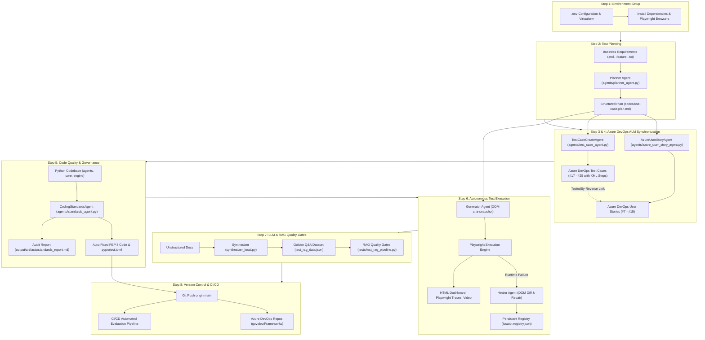

# Autonomous Agentic Playwright Framework - Step-by-Step Workflow Guide

This document provides an end-to-end, step-wise operational workflow for developing, governing, executing, and synchronizing tests across the **Autonomous Agentic Playwright Framework**.

---

## 🗺️ End-to-End Workflow Architecture



---

## Step 1: Environment Setup & Initialization

### 1.1 Create and Activate Virtual Environment

Open PowerShell in the project directory:

```powershell
# Navigate to project directory
cd E:\AI_PORTABLE\PROJECTS\playwrightFrameworkPythons

# Create Python virtual environment (if not already present)
python -m venv venv

# Activate virtual environment
.\venv\Scripts\Activate.ps1
```

### 1.2 Install Required Dependencies

Install the core testing, evaluation, and LLM packages:

```powershell
pip install -r requirements.txt
```

### 1.3 Install Playwright Browser Binaries

Download and register the required Chromium browser engines:

```powershell
playwright install chromium
```

### 1.4 Configure Environment Variables (`.env`)

Copy the template configuration file:

```powershell
Copy-Item .env.example .env
```

Open `.env` and verify the required configuration:

```env
# Azure DevOps Configuration
AZURE_DEVOPS_ORG=govidev
AZURE_DEVOPS_PROJECT=Frameworks
AZURE_DEVOPS_PAT=your_azure_devops_pat_token

# LLM Providers (auto | openai | gemini | anthropic | mock)
LLM_PROVIDER=auto
OPENAI_API_KEY=your_openai_api_key
GEMINI_API_KEY=your_gemini_api_key

# Playwright Browser Execution Settings
BROWSER_TYPE=chromium
HEADLESS=true
ACTION_TIMEOUT=15000
SELF_HEALING_ENABLED=true
```

> [!TIP]
> The framework operates fully offline using heuristic engines when running with `--provider mock` or when LLM API keys are omitted.

---

## Step 2: Requirements Ingestion & Test Planning

Transform raw business requirements into a structured, production-grade Use Case Test Plan using the [`PlannerAgent`](file:///e:/AI_PORTABLE/PROJECTS/playwrightFrameworkPythons/agents/planner_agent.py).

### 2.1 Run the Test Planner

Execute the planner in `--plan-only` mode against requirements and a target URL:

```powershell
# Generate test plan from requirements document
python main.py --requirement tests/sample_requirements/automationpractice.md --url https://shop.qaautomationlabs.com/index.php --plan-only
```

To specify an explicit output file destination:

```powershell
python main.py --requirement tests/sample_requirements/automationpractice.md --url https://shop.qaautomationlabs.com/index.php --plan-output specs/use-case-plan.md --plan-only
```

### 2.2 Verify Generated Test Plan Structure

Open and review [`specs/use-case-plan.md`](file:///e:/AI_PORTABLE/PROJECTS/playwrightFrameworkPythons/specs/use-case-plan.md). Ensure each scenario complies with the standard schema:

```markdown
## [Scenario ID] [Scenario Title]
- **Actor:** [Target Persona, e.g. Customer / Guest User]
- **Preconditions:** [State prerequisite]
- **Main Flow / Steps:**
  1. [Action step 1]
  2. [Action step 2]
  ...
- **Alternate / Exception Flows:**
  - [Failure handling, validation alerts, or alternative routes]
- **Expected Outcome:** [Observable verification asserting success]
```

---

## Step 3: Agile Synchronization - User Stories Creation

Publish the decomposed Use Cases into Azure DevOps Boards as structured User Stories using [`AzureUserStoryAgent`](file:///e:/AI_PORTABLE/PROJECTS/playwrightFrameworkPythons/agents/azure_user_story_agent.py) conforming to [`CreateUserStory.md`](file:///e:/AI_PORTABLE/PROJECTS/playwrightFrameworkPythons/CreateUserStory.md).

### 3.1 Execute the User Story Creation Agent

```powershell
# Create User Stories in Azure DevOps from specs/use-case-plan.md
python main.py --azure-stories
```

*(Optional) Pass a custom Personal Access Token directly:*

```powershell
python main.py --azure-stories --pat "<YOUR_PAT>"
```

### 3.2 Review Generated User Stories

- The agent will output console confirmation for each created story.
- Inspect the generated audit log in [`specs/azure-user-stories.md`](file:///e:/AI_PORTABLE/PROJECTS/playwrightFrameworkPythons/specs/azure-user-stories.md) containing IDs (`#7` through `#15`) and direct URLs to the Azure DevOps Boards.

---

## Step 4: Agile Synchronization - Test Cases Creation with XML Steps

Generate specialized `Test Case` work items in Azure DevOps Boards with structured XML test steps (`Microsoft.VSTS.TCM.Steps`) and link them to their parent User Stories using [`TestCaseCreateAgent`](file:///e:/AI_PORTABLE/PROJECTS/playwrightFrameworkPythons/agents/test_case_agent.py) conforming to [`CreateTestCases.md`](file:///e:/AI_PORTABLE/PROJECTS/playwrightFrameworkPythons/CreateTestCases.md).

### 4.1 Execute the Test Case Creation Agent

```powershell
# Create Test Cases with XML steps and link to User Stories
python main.py --test-cases
```

### 4.2 Verify Traceability & XML Step Structure

1. **XML Step Encoding**: Verify that actions and validations are formatted as XML within the `/fields/Microsoft.VSTS.TCM.Steps` field:
   ```xml
   <steps id="0" last="5">
     <step id="2" type="ActionStep">
       <parameterizedString isformatted="true">Click autofill demo credentials button</parameterizedString>
       <description/>
     </step>
     <step id="3" type="ValidateStep">
       <parameterizedString isformatted="true">Click login submit button</parameterizedString>
       <parameterizedString isformatted="true">Redirects to product catalog page</parameterizedString>
     </step>
   </steps>
   ```
2. **Traceability Links**: Verify bidirectional relations (`Microsoft.VSTS.Common.TestedBy-Reverse`) linking each Test Case (`#17` through `#25`) to its parent User Story (`#7` through `#15`).
3. **Audit Log**: Inspect [`specs/azure-test-cases.md`](file:///e:/AI_PORTABLE/PROJECTS/playwrightFrameworkPythons/specs/azure-test-cases.md).

---

## Step 5: Code Quality & PEP 8 Standards Governance

Audit and auto-fix the codebase against [`Coding_Standards_python.md`](file:///e:/AI_PORTABLE/PROJECTS/playwrightFrameworkPythons/Coding_Standards_python.md) using the pure-Python [`CodingStandardsAgent`](file:///e:/AI_PORTABLE/PROJECTS/playwrightFrameworkPythons/agents/standards_agent.py).

### 5.1 Audit Code Quality

Inspect the codebase for PEP 8 compliance, line length (88 max), indentation (no tabs), blank lines, and import grouping:

```powershell
# Audit entire workspace
python main.py --standards .

# Audit specific directory
python main.py --standards agents/
```

### 5.2 Automatically Fix Standards Violations

Run the agent with `--standards-fix` to automatically format tabs to 4 spaces, clean consecutive blank lines, and sort import blocks:

```powershell
python main.py --standards agents/ --standards-fix
```

### 5.3 Generate Tooling Configuration (`pyproject.toml`)

Generate or synchronize production tool configurations for Ruff, Black, and Mypy:

```powershell
python -m agents.standards_agent --gen-config
```

Review the generated audit report in [`output/artifacts/standards_report.md`](file:///e:/AI_PORTABLE/PROJECTS/playwrightFrameworkPythons/output/artifacts/standards_report.md).

---

## Step 6: Autonomous Playwright Test Execution & Self-Healing

Execute autonomous, end-to-end browser tests against live applications.

### 6.1 Execute Live Test Journey

```powershell
# Run autonomous execution against target web application
python main.py --requirement tests/sample_requirements/saucedemo_checkout.md --url https://www.saucedemo.com
```

### 6.2 Self-Healing Lifecycle

When dynamic DOM changes or locator breakages occur during execution:
1. **Interceptor Hook**: Runtime catches `TimeoutError` or `NoSuchElementException`.
2. **Context Snapshot**: Captures current DOM tree, viewport screenshot, and target intent.
3. **Semantic Healing**: [`HealerAgent`](file:///e:/AI_PORTABLE/PROJECTS/playwrightFrameworkPythons/agents/healer_agent.py) calculates semantic match and accessibility tree similarity to formulate replacement locators.
4. **Live Verification**: Verifies candidate locators directly in the running browser session.
5. **Registry Update**: Stores verified replacement locators in [`locator.registry.json`](file:///e:/AI_PORTABLE/PROJECTS/playwrightFrameworkPythons/locator.registry.json) for instant reuse.
6. **Execution Resume**: Resumes the workflow without aborting the test suite.

### 6.3 Inspect Execution Artifacts

After execution, examine generated artifacts in `output/artifacts/`:
- **HTML Dashboard**: Open `output/artifacts/reports/execution_report.html` in your browser to view step-by-step timings, pass/fail status, and self-healing audit comparisons.
- **Playwright Trace Viewer**:
  ```powershell
  npx playwright show-trace output/artifacts/traces/trace_<timestamp>.zip
  ```
- **Screenshots & Video**: Stored under `output/artifacts/screenshots/` and `output/artifacts/videos/`.

---

## Step 7: LLM & RAG Quality Gating & Golden Set Generation

Evaluate GenAI and RAG pipelines against strict quality gate thresholds ($\tau$).

### 7.1 Generate Synthetic Golden Datasets

Generate domain-specific, evaluated Q&A pairs from unstructured documentation without manual annotation:

```powershell
# Generate 10 synthetic Q&A evaluation pairs
python synthesizer_local.py --doc tests/sample_requirements/amazon_20_requirements.md --output test_rag_data.json --max-items 10
```

### 7.2 Run Pytest RAG Quality Gate Suite

Execute automated quality assertions evaluating Faithfulness, Answer Relevancy, Contextual Precision, and Contextual Recall:

```powershell
# Run standard suite
pytest -v tests/test_rag_pipeline.py

# Parallel execution across CPU cores
pytest -v -n auto tests/test_rag_pipeline.py
```

### 7.3 Quality Gate Pass/Fail Criteria

| Target Component | Metric | Minimum Threshold ($\tau$) | Failure Addressed |
| :--- | :--- | :---: | :--- |
| **Generator** | **Faithfulness** | $\ge 0.85$ | Hallucination; ungrounded claims |
| **Generator** | **Answer Relevancy** | $\ge 0.80$ | Incomplete, evasive, or off-topic responses |
| **Retriever** | **Contextual Precision** | $\ge 0.75$ | Low MRR; high context noise |
| **Retriever** | **Contextual Recall** | $\ge 0.80$ | Missing reference facts; under-retrieval |

Results are exported to `output/artifacts/reports/rag_eval_report.json`.

---

## Step 8: CI/CD & Version Control Synchronization

Synchronize code, test plans, and test artifacts with Azure DevOps Git Repositories and trigger automated pipelines.

### 8.1 Run Pre-Commit Test Suite

Ensure all unit and integration tests pass before staging changes:

```powershell
# Run agent and framework tests
pytest tests/test_test_case_agent.py tests/test_azure_user_story.py tests/test_planner.py tests/test_standards_agent.py -v
```

### 8.2 Check Git Status & Stage Changes

```powershell
# Check working directory status
git status

# Stage all updated files and artifacts
git add .
```

### 8.3 Commit with Semantic Message

```powershell
git commit -m "feat: complete end-to-end test planning, Azure DevOps work item sync, and standards enforcement"
```

### 8.4 Push to Azure DevOps Remote

```powershell
git push origin main
```

---

## ⚡ Quick Command Reference Cheat Sheet

| Task | Command |
| :--- | :--- |
| **Generate Test Plan Only** | `python main.py --requirement <REQ_FILE> --url <URL> --plan-only` |
| **Create Azure User Stories** | `python main.py --azure-stories` |
| **Create Azure Test Cases (XML)** | `python main.py --test-cases` |
| **Audit Coding Standards** | `python main.py --standards .` |
| **Auto-Fix Coding Standards** | `python main.py --standards agents/ --standards-fix` |
| **Generate Tooling Config** | `python -m agents.standards_agent --gen-config` |
| **Run E2E Browser Test** | `python main.py --requirement <REQ_FILE> --url <URL>` |
| **Synthesize RAG Golden Data** | `python synthesizer_local.py --doc <DOC_FILE> --output test_rag_data.json` |
| **Run RAG Quality Gates** | `pytest -v tests/test_rag_pipeline.py` |
| **View Playwright Trace** | `npx playwright show-trace <TRACE_ZIP>` |
| **Push to Azure DevOps Repo** | `git push origin main` |

---

## 🔧 Troubleshooting Guide

| Issue | Root Cause | Solution |
| :--- | :--- | :--- |
| `Azure DevOps API returned 401 Unauthorized` | Invalid or expired PAT token | Update `AZURE_DEVOPS_PAT` in `.env` or pass `--pat <TOKEN>` directly. Ensure PAT has `Work Items (Read & Write)` scope. |
| `Automation status 'Automated' is not supported` | Work item template restriction in Azure DevOps Boards | The field is managed automatically. Do not manually force `Automated` status in REST API payload; defaults to `Not Automated`. |
| `Playwright Executable Doesn't Exist` | Missing browser binaries | Run `playwright install chromium` in your activated virtual environment. |
| `Line length exceeds 88 characters` | PEP 8 / Black formatting violation | Run `python main.py --standards <DIR> --standards-fix` to reformat lines and imports automatically. |
| `RAG Faithfulness metric failed (< 0.85)` | Response contains ungrounded claims or hallucinations | Ensure generator temperature is set to $\le 0.2$ and prompt instructions mandate refusal on insufficient context. |
